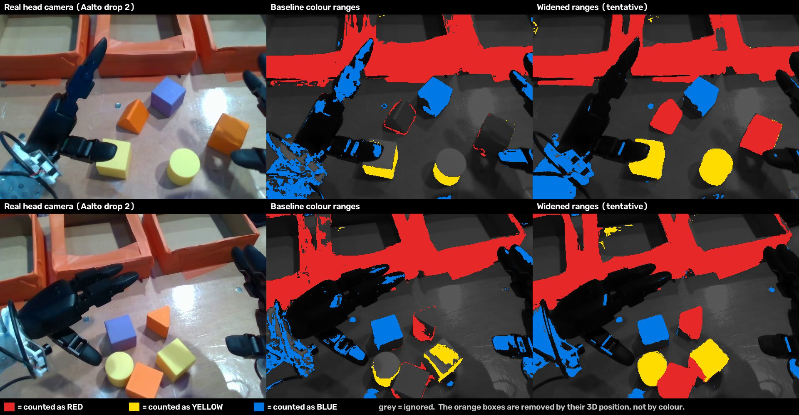

# Aalto Discord: organiser answers that matter

Facts from the Aalto challenge channel on the Junction Discord, with what each means for us. **Newest first; add new answers at the top.** Copied by Samer on Sat 14 Nov ~12:00.

| When | Who | What they said | What it means for us |
|---|---|---|---|
| Sat ~14:10 | Another team, in the channel | Posted the timeline from Aalto's own brief ("Sat: … Organisers pick the finalists. Sun: Final submission (Docker image), real-robot finals, award") and asked: "How are the finalists picked on Saturday? Do we need to submit something today?" | **Conflicts with Aalto's in-person answer below** (one deadline, Sun 10:00). Watch for Aalto's reply in the channel. Until then, submit v1 today if the form is open. Drop 1's empty-scene depth will also show the real camera angle |
| Sat ~12:50 | Aalto, in person (asked by Samer) | (1) *Correction:* no deadline was confirmed. Samer had assumed Sun 10:00, which is Junction's platform deadline; Aalto hasn't announced the image deadline. (2) **The finals PC will have internet.** (3) A test run of our image on the real robot before the finals: no answer yet | Image deadline unknown: submit a working v1 tonight. Live API calls (e.g. Gemini) are possible in the finals, but a failed or slow call still counts as a failure, so keep the offline fallback. Assume no real-robot test |
| Sat 11:41 | erkka (Aalto) | The sim's object colours are wrong (red, blue, yellow). "We will use the ones we have (purple, yellow, orange). Feel free to edit the simulation how you see fit." "You need to make your sim really accurate to our setup if you want to have any chance of having the sim2real work." | **Perception and the instruction parser must handle the real colours (orange, purple) and the sim ones (red, blue).** The held-out sim variant is probably still Aalto's sim. See the colour check below. Still unconfirmed: in rung 1's fixed sentence ("red → left … blue → right"), does red mean orange and blue mean purple? |
| Sat 11:37 | erkka | Drop 2 is out: `zupermiez/g1_junction_drop_2` | Single-object demos; they break the speed caps. See [`real-data-findings.md`](real-data-findings.md) |
| Sat 09:47 | erkka | Finals: "we will connect a pc with rtx5090 to the robot via ethernet so bigger models can also fit. Please notify us well in advance if you plan to do something like this so we can start downloads early" | If our image grows (e.g. π0.5 weights), tell Aalto early |
| Sat 01:54 | erkka | First dataset `zupermiez/g1_pick_cube`: "a significant part of the data is 'suboptimal'. You will have to work on it yourself. Starting from the labels themselves. Better datasets coming tomorrow." | Don't trust the labels; curate. The drops have no success labels at all |
| Sat 01:00 | erkka | Answers to team The Larp Interns: (1) oracle not re-measured on the sim clock (~84 % before, triangles the main miss); (2) Dex3 gains kp 1.5 / kd 0.2, fixed and the same for every team; (3) pad friction not measured: the pads are rubber, the sim's 1.2 / 1.0 is "on the grippy side, so expect a bit less grip on the real robot"; (4) finals instructions: "colour comes first. If several teams handle colour, we may also test shape-based instructions. **No negation.**" | Tune grasps with **lower friction** in randomisation. **Shape-based instructions are likely** if we're good at colour, so parse shapes and estimate shape in perception. Negation is off the list |
| Sat 00:25–00:45 | erkka | Little data overnight: teleop only works over Wi-Fi from the VR goggles, and the venue Wi-Fi is unusable. "the whole challenge is anyway to try to make do with little real world data" | Aalto has a data-collection problem. A **wired** teleop (Rokoko Smartgloves II stream over USB; the Coil Pro has no radio) would solve it. That's an angle for a Rokoko project |
| Fri 21:40 | erkka | "no need to wait for the docker image btw you can build everything based on the repo" | Bare-metal install is fine (what we did) |
| Fri 21:40 | erkka | Asked whether the robot will have internet: "yes it can have" | **Contradicts the repo docs** ("we provide no network"). Confirm before relying on any API at runtime; keep an offline fallback regardless |
| Fri 19:42 | erkka | Challenge summary: 3 levels; Docker server at 30 Hz; sim evaluation → finalists → real robot on Sunday; "External APIs at your own risk; no guaranteed internet in the finals"; "Organisers reserve the right to change rules and details during the event" | — |

## Colour check on the robot's own camera (Sat 14 Nov ~12:50)

Measured on 5 head-camera frames (`cam_high`) from drop 2, in OpenCV HSV (hue 0–180), against the classical baseline's ranges in `baselines/classical/config.yaml`:

| Thing | Hue in the robot's camera | Saturation | Baseline range | Result with the baseline |
|---|---|---|---|---|
| Orange objects | 11–13 | 150–220 | red: 0–8 and 170–180 | **Missed:** falls between red and yellow (only thin edges match) |
| Yellow objects | 34–46 (looks pale green-yellow) | 72–88 | yellow: 18–35, S ≥ 70 | **Mostly missed:** only the most orange-ish face matches |
| Purple objects | ~110 (looks blue to this camera) | 140–150 | blue: 100–130 | Detected as blue |
| Orange boxes | 4–7 | 130–200 | red | Counted as "red"; removed only by their 3D position (depth + calibration) |
| Black Dex3 hands, silver wrist | ~103 (blue tint) | high | blue, V ≥ 50 | **Edges and the wrist count as "blue":** false objects unless filtered by height or arm position |
| Plywood table, glare | any | 5–35 | S ≥ 70 | Ignored (good) |

- **On the real robot the stock baseline would sort mostly the purple objects.**
- **In the sim, the red objects are redder than the orange boxes; on the real robot, the boxes are redder than the orange objects.** So colour alone can't separate boxes from "red" objects in both worlds. The 3D box mask has to do it.
- **The widened ranges in the image are a first guess from 5 frames:** warm H 0–17 and 165–180 (S ≥ 90), yellow H 18–55 (S ≥ 50, V ≥ 100), cool H 90–165 (S ≥ 60, V ≥ 100). Validate them on many more real frames and on the sim (default look, venue look, randomisation) before using them.
- **Caveat:** these frames came through the teleop camera stream; the finals use Aalto's RGB-D server, so colours may shift a little. Re-check on Drop 1 (venue capture through that path) when it lands.
- The earlier estimate from Emīls's phone photo (orange ~15, yellow ~26, purple ~129) was off for yellow and purple: the phone and the robot's camera see colours differently.

## Other teams seen in the channel
- **The Larp Interns** (Oliver): measuring oracle scores, asking about Dex3 gains and pad friction. They're doing careful real2sim; treat them as strong.
- **yo_mama:** asked how the finals computer connects to the robot.
- **Mr.OREO:** asked about internet on the robot.
