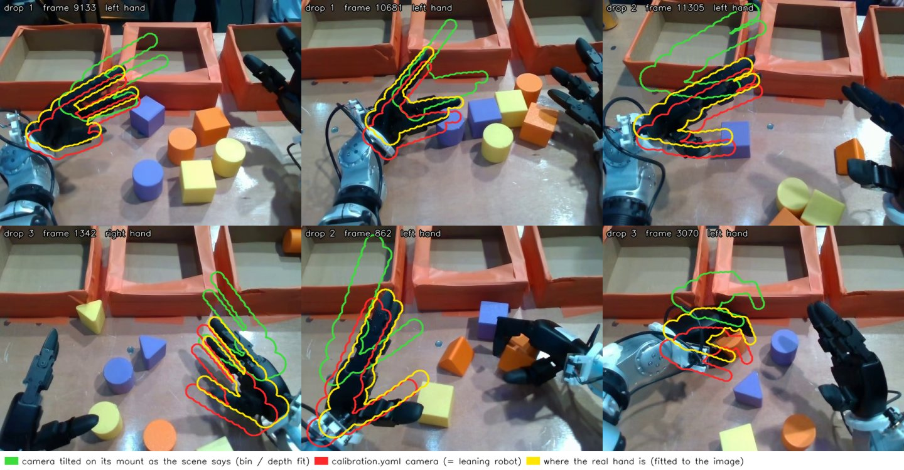
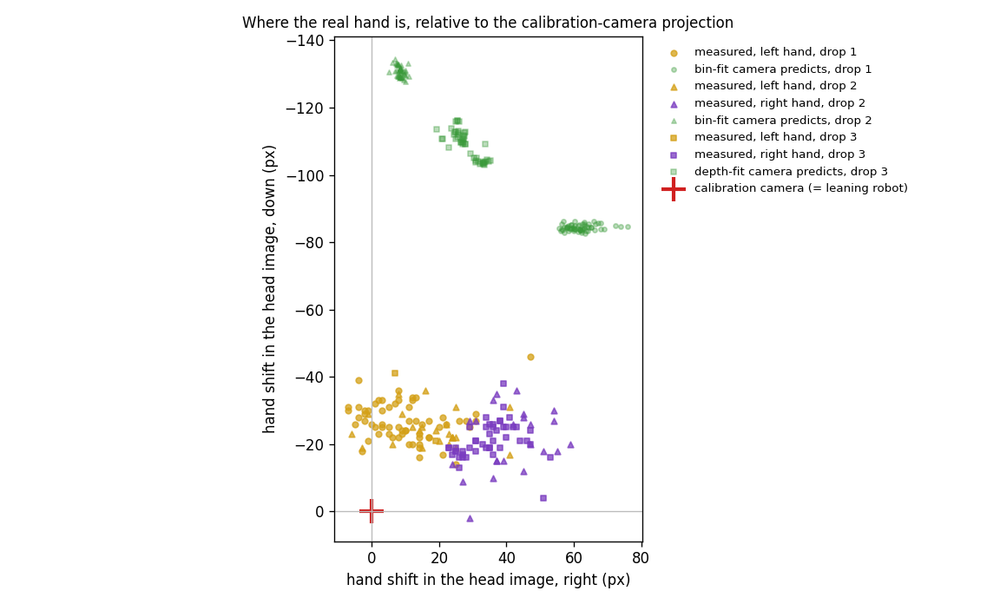

# Why the real hand looks 4–6 cm off: the robot leans, the camera is (almost) where calibration.yaml says

**Question:** in Aalto's real footage the Dex3 hand sits 4–6 cm closer to the robot (lower in the head image) than our venue-look model puts it at the same joint angles (`sim/venue_look/README.md` row 1b). Is the head camera tilted on its mount (what v1.4's camera fit, Emīls's `decision_oracle/camera.py` and Marcus's agent assume), does the whole robot lean (camera and arms together), or are the arms off?

**Short answer (FACT, measured Sun 15 Nov ~01:00, Samer + Claude, on all three of Aalto's real datasets):** the robot leans; the camera is tilted on its mount by only ~2°.
- **Camera vs arms:** relative to the arms, the head camera is within **~2.2°** of `calibration.yaml` in all three datasets (2.5°, 2.2°, 2.0°).
  - Projected through `calibration.yaml`, the joint-angle hands land **2.5 cm** (median) from the real hands.
  - Through the camera fitted to the scene they land **6.3 cm** away. That is the "4–6 cm" of row 1b.
- **Robot vs table:** the scene fits show the robot leaning forward relative to the table by different amounts in each session.
  - The camera looks 7.9° (drop 1, bins), 12.2° (drop 2, bins) and **14.5°** (drop 3: our policies' own `fit_head_pose` on real depth, 14.2–15.2° in all 15 episodes) further down than `calibration.yaml`.
  - Since the camera sits ~2.2° down relative to the arms, the upper body (camera and arms together) leans forward about **5.5°, 10° and 12.5°** relative to the table.
- **What remains is a per-arm offset**, as seen by `calibration.yaml`'s camera:
  - **left hand 1.5 cm forward, 0.8 cm to the robot's right, 1.1 cm up;**
  - **right hand 0.9–1.5 cm forward, 2.4 cm to the right, 0.8–1.1 cm up.**

  Along the camera's line of sight it is +0.6 cm (right hand, measured with drop 3's depth).
- **What this means for v1.4, v1.5, v1.6 and the ADK agent (OPINION):** they use the fitted camera as the camera→arm transform. On the real robot that puts each hand **6–9 cm short of the object and too low** (§5). Keep the fit for perception, but map every arm target into the arm frame, and raise v1.4's 15° fit limit (§6).


*Six of the 158 frames used, all three datasets, both hands.*
- *Green: the camera tilted on its mount as the scene says (bin fit in drops 1–2, our policies' depth fit in drop 3). This is what v1.4 and the venue look assume.*
- *Red: `calibration.yaml`'s camera, which is what a leaning robot looks like in the image.*
- *Yellow: where the real hand is (the hand model slid onto the dark hand pixels).*

*The hand model is spheres on Aalto's kinematics; the real hand is the near-black shape.*

## 1. Method
Script: [`eval/analysis/hand_offset.py`](../../eval/analysis/hand_offset.py). Data: Aalto's three real datasets on Hugging Face, all 30 Hz joint angles + head camera `cam_high`:

| Dataset | Name here | Episodes | Head depth |
|---|---|---|---|
| `zupermiez/g1_pick_cube` | drop 1 | 20 | no |
| `zupermiez/g1_junction_drop_2` | drop 2 | 48 | no |
| `zupermiez/g1_junction_drop_3` | drop 3 (published Sun 00:07) | 15 | yes, aligned to `cam_high` (checked by overlaying depth edges on the image) |

1. **Frames:** we keep frames where an arm and its fingers are still for ±133 ms, so camera/joint sync can't matter (left ≤ 0.015 rad, right ≤ 0.03 rad: the right arm is rarely still while in view). The hand must be fully in view with *both* candidate cameras, so the choice favours neither, and away from the other hand. That gives up to 12 frames per episode and hand: 273 (frame, hand) pairs.
2. **Hand model:** Aalto's kinematics (G1 URDF, pelvis frame, waist at 0; the same points as `ArmKinematics.hand_points`) give the palm and finger links. 3×3 spheres in the palm (r 1.6 cm) and spheres along each finger (r 1.0 cm) make a silhouette.
3. **Where the real hand is:** a mask of Dex3 pixels: dark, bluer than red, saturated. That rejects the pink table, its grey shadows and the brown bin interiors. The silhouette projected through `calibration.yaml` is slid over the mask (±110 px sideways, −170…+110 px vertically). The score is silhouette pixels on the mask minus ring pixels on the mask (a 14 px ring around the silhouette). The best shift is where the real hand is.
4. **Which registrations count:** 158 of 273 score ≥ 0.4, from 56 episodes: 88 left hand, 70 right. Checked by eye: the ones below 0.4 are mostly a hand at the image's left edge, half masked, where the outline slides onto the table.
5. **Models:** each model predicts the image position of the 8 hand points. Its parameters are fitted to all registrations by robust least squares (soft L1, 8 px), and 90 % intervals come from resampling whole episodes (200×).
6. **Drop 3 only:**
   - our policies' head fit (`policy/headpose.py` `fit_head_pose`, the same code as v1.4 and Emīls's `decision_oracle`) on each episode's first depth frame;
   - `look.py`'s depth hand check;
   - the hand's 3-D offset: each registered sphere pixel back-projected at the measured depth.

## 2. Results: which explanation fits
Median error of the hand position in the image (px, and cm at the hand), 158 registrations:

| Model | Parameters (90 % interval) | All | Drop 1 | Drop 2 | Drop 3 |
|---|---|---|---|---|---|
| **1. Camera tilted on its mount as the scene says** (v1.4 / venue look) | fixed: bin fit 7.9° / 12.2°, depth fit ~14.5° further down | 88 px / **6.3 cm** | 80 px / 6.0 cm | 109 px / 7.6 cm | 90 px / 6.2 cm |
| **2. Robot leans** (camera + arms together) = `calibration.yaml` camera in the image | none | 33 px / **2.5 cm** | 29 px / 2.2 cm | 37 px / 2.7 cm | 42 px / 2.7 cm |
| **3. `calibration.yaml` camera + per-arm offset** (across the line of sight) | left (+1.5, −0.8, +1.1) cm, right (+0.9, −2.4, +1.1) cm | 9.7 px / **0.7 cm** | 9.4 px | 9.8 px | 5.6 px |
| 2b. Camera rotation fitted to the hands | pitch **+2.2°** [2.1, 2.4] further down, yaw −2.2° [−2.6, −1.5], roll −0.2° [−0.5, 0.3] | 14.3 px / 1.0 cm | 8.8 px (pitch +2.5° [2.3, 2.7]) | 14.9 px (+2.2° [1.9, 2.4]) | 7.6 px (+2.0° [1.9, 2.2]) |
| 1b. Scene's camera + per-arm offset | left offset (−3.6, +4.1, −2.2) cm in drop 1 but (−6.0, −0.4, −4.1) cm in drop 2 | 17.5 px, rms 32 px | 8.2 px | 9.3 px | 12.6 px |

How to read it:
- **The hands rule out an 8–15° mount tilt.** The camera that fits the hands is 2.0–2.5° further down than `calibration.yaml` in every dataset. The scene says 7.9°, 12.2° and 14.5°. A camera bolted into the head can't change by 7° between sessions while the arms stay put. A robot standing or leaning differently can.
- **"Tilted mount + offset arms" (1b) fits each dataset alone,** because over a small range of hand positions a constant offset can stand in for a rotation. But it needs arm offsets of 4–7 cm that differ between datasets, and joint offsets don't change between sessions.
- **The residual after model 3 (~0.7 cm, 10 px) is the measurement's own scatter.** Model 3 is 6 parameters, 2b is 3. 2b fits the arms separately better than together: the right arm wants −3.3° yaw, the left −1.0°, so the arms differ. Splitting the remaining ~2 cm between "camera 2° down on its mount" and "both arms 1.5–2.5 cm off" is not possible from these data. For targets on the table the two differ by ~1.2 cm (§5).


*Each dot is one (frame, hand): where the real hand is, relative to where `calibration.yaml`'s camera puts it (red cross). Green: where the camera tilted on its mount (bin fit / depth fit) would put the same hand. The measured hands sit 18–66 px from the red cross (median 33 px); the green clouds sit 101–134 px from it.*

## 3. Per-arm numbers
The real hand's position minus the joint-angle hand position, pelvis frame, with `calibration.yaml`'s camera:

| Arm | x (forward) | y (+ = robot's left) | z (up) | Frames (episodes) | Per dataset |
|---|---|---|---|---|---|
| **left** (RGB) | **+1.5 cm** [1.4, 1.6] | **−0.8 cm** [−1.0, −0.6] | **+1.1 cm** [1.0, 1.2] | 88 (33) | drop 1 (+1.6, −0.6, +1.2), drop 2 (+1.4, −1.2, +0.8), drop 3 (+1.7, −0.9, +1.1; 2 frames) |
| **right** (RGB) | **+0.9 cm** [0.8, 1.0] | **−2.4 cm** [−2.6, −2.3] | **+1.1 cm** [1.1, 1.2] | 70 (27) | drop 2 (+1.0, −2.9, +1.1), drop 3 (+0.9, −2.3, +1.2) |
| right, with drop 3's depth | +1.5 cm (1.1–1.7) | −2.4 cm (−2.6…−2.2) | +0.8 cm (0.4–1.0) | 47 (13) | line of sight: +0.6 cm (real hand further from the camera) |

- **RGB rows** measure the offset only across the camera's line of sight; the part along it is set to 0. Brackets: 90 % interval from resampling episodes.
- **The depth row** measures all three components; its ranges are the interquartile range over frames. Its line-of-sight part (+0.6 cm) is within the hand model's own uncertainty, so the RGB numbers are effectively the 3-D offsets.
- **Equivalent single correction for both arms:** the camera 2.2° further down and 2.2° turned to the robot's left, `camera(T0, pitch=2.22, roll=-0.17, yaw=-2.17)` in the script's convention (the same as `sim/venue_look/tools/fit_head_camera.py`).

## 4. Drop 3: real head depth
- **Our policies' head fit works on real depth and finds 14.2–15.2° in all 15 episodes** (median 14.5°, table plane on ~50 % of the points, bin walls ~0.44, the camera moved 3.5–4.1 cm). **v1.4's `camera_move_ok` rejects one of the 15 (15.2° > its 15° limit)** and would then run that episode on `calibration.yaml` with a table that looks 15° tilted.
- **`look.py`'s depth hand check can't decide on the real robot.** On 60 frames the median depth error is 8.9 cm with `calibration.yaml` and 10.5 cm with the fitted camera. Its verdict:

  | Verdict | Frames |
  |---|---|
  | inconclusive | 55 |
  | LEANING ROBOT | 3 |
  | unclear | 2 |

  The reason: 3 of its 8 points are the grasp point (in the air between the fingers) and the fingertip ends, and with a 2–3 cm offset most of them land on the table behind the hand. The registration in this note does what it was meant to do.

## 5. What this does to a policy's grasps
Hand-to-object distance for objects where the real ones lie (pelvis x 0.20–0.34 m, |y| ≤ 0.15 m on that arm's side, `sim/venue_look/README.md`). The robot-to-table pose is taken from each dataset's scene fit (drop 3: every episode's depth fit). Median (max), cm.

| How the policy turns a seen object into an arm target | Drop-1 stance (lean ~5.5°) | Drop-2 stance (~10°) | Drop-3 stance (~12.5°) |
|---|---|---|---|
| **Fitted camera used for the arms** (v1.4, v1.5, v1.6, ADK agent, decision_oracle camera mode) | left **6.4** (6.7), right **6.0** (6.5) | left **8.5** (9.4), right **9.3** (10.3) | left **7.7** (8.6), right **8.0** (9.1) |
| `calibration.yaml` camera, no fit (v1.2/v1.3 after rejecting the fit) | left 2.0–2.6, right 2.6–3.0, **but** the table looks 8–15° tilted, so bin walls become "objects" (v1.3 0/9 in the venue look) | same | same |
| **Fit for perception, targets mapped into the arm frame + per-arm offset** (§6) | 0 by construction; 1.1–1.2 (1.4) if model 2b is the truth instead | same | same |

In the arm frame the objects are 6–9 cm further forward and 2.5–7 cm higher than the fitted frame says. The bins are 6–9 cm further and 7–11 cm higher. A fitted-frame plan therefore closes the hand short of the object and low, near or into the table, and drops short of the bin centre, low enough to hit the near wall.

## 6. What each policy should do (OPINION, Samer + Claude; not tested on the robot)
1. **v1.4, v1.5, v1.6, Marcus's ADK agent, decision_oracle in camera mode: keep the camera fit ON for perception and OFF as the camera→arm transform.** Today these policies set `T_pelvis_optical = fit.T` and plan in that frame. The fit is right about the table, bins and objects relative to the camera; the arms just don't live in that frame on the real robot. Keep planning in the fitted frame, and map each Cartesian point to the arm frame just before IK, as below. Map directions (the "down" approach axis, lift) with `M[:3, :3]`. In the drop-3 stance the table's vertical is ~15° from the arms' z.
   ```python
   # Once per episode, after the head fit is accepted: T0 = calibration.yaml pose, T_fit = fit.T (pelvis <- optical)
   REAL = fit.tilt_deg >= 5.0                          # real footage 8-15 deg; Aalto's sims ~1 deg (nominal), ~2 deg (DR)
   M = T0 @ np.linalg.inv(T_fit) if REAL else np.eye(4)     # fitted (table) frame -> arm frame
   OFFSET = {"left": np.array([0.015, -0.008, 0.011]), "right": np.array([0.012, -0.024, 0.010])}  # m, real robot only
   def arm_target(p, side):                            # p: a point the planner computed in the fitted frame
       return M[:3, :3] @ p + M[:3, 3] - (OFFSET[side] if REAL else 0.0)
   ```
   - **Where to apply it:** for v1.x (Aalto's classical planner), a subclass of `ArmKinematics` with `solve()` mapping its target and `grasp_pose()` mapping back with `inv(M)` (+ offset). Also set `aaltonomous.baselines.classical.kinematics.DOWN = M[:3, :3] @ [0, 0, -1]`, which the IK reads at call time. For v1.5/v1.6/ADK, the same at whatever IK call the oracle motions use.
   - **Fallback:** without the per-arm offsets, `camera(T0, 2.22, -0.17, -2.17)` in place of `T0` in `M` does almost as well (~1.2 cm worse).
   - **The right arm's offset** is the mean of its RGB (+0.9, −2.4, +1.1) and depth (+1.5, −2.4, +0.8) estimates.
2. **Raise v1.4's fit limit.** `camera_move_ok(max_tilt_deg=15)` rejected 1 of 15 real episodes (15.2°), and the lean grows from session to session (5.5° → 10° → 12.5°). Something like 25° is needed; the camera itself moved only 3.5–4.1 cm (limit 6 cm). The same applies to the copy in Marcus's agent (`adk_agents/robot_sorter/headpose.py`).
3. **Gate the mapping to the real robot.** In Aalto's sims the arms and the table share the pelvis frame, so there the fit *is* the camera→arm transform and `M` must stay identity. The 5° tilt threshold separates the real footage (8–15°) from Aalto's nominal and randomised sims (fits of ~1° and ~2°, `docs/CONTEXT.md` §4.4). It would misfire only if Aalto's held-out variant tilts its camera more than 5°.
4. **Our venue look models the wrong cause.** It tilts the camera on its mount, so the hand fits there say "tilted camera" (e-034) and its scores for v1.4/v1.5 say nothing about the real arm error. With the gate above it would also switch the mapping on where it is wrong. To test the fix in sim, the venue look should tilt the camera ~2° on its mount and pitch the robot (or table, bins and objects together about the pelvis) ~10–12°.
5. **The `look` image:** don't wait for its hand-check verdict; on real depth it is "inconclusive" 55 times out of 60 (§4). Its fit line (tilt, camera move, "v1.4 USES it") is still worth logging on the robot: it gives that day's lean.
6. **v1.2 / v1.3** reject a ~10–15° fit and run on `calibration.yaml`: arms within 2–3 cm, but the tilted table breaks their perception. Not a real-robot option.
7. **Height checks:** in the arm frame the real table rises with distance: at x = 0.34 m it sits 4.5–7 cm above the `counter_z` = 0.01 m of `scene.yaml`, and 7–11 cm at the bins (drop 1–2 stances). A clearance check against `counter_z` in the pelvis frame (ours or the safety filter's) then doesn't keep the hand off the far table. Do clearance checks in the fitted frame, before mapping.

## 7. Checks
- **Kinematics:** the script's numpy kinematics match Aalto's `ArmKinematics.hand_points` (Pinocchio 4.1) to < 1 nm on 1,200 recorded poses (300 per dataset and arm, drops 1–2). They also reproduce `calibration.yaml`'s head pose from the URDF exactly and the `closed`-posture fingertips in Aalto's `config.yaml`.
- **By eye:** on clear frames the shifted hand's fingertips sit on the real fingertips. The `calibration.yaml` fingertips are 20–35 px low.
- **Not a hand-shape artefact:** the measured shift is the same whatever direction the fingers point in the image (drops 1–2: +26, −30 px constant, −4 px along the fingers).
- **Sensitivity** (drops 1–2; finger radius 0.8–1.2 cm, palm radius 1.3–1.9 cm, palm ±1 cm, ring 8–22 px, mask V < 65 … V < 95):
  - camera pitch +2.3…+2.6°;
  - left offset (+1.9…+2.4, −0.7…−1.4, 0…+1.0) cm;
  - right (+1.2…+1.6, −2.5…−3.3, +0.2…+1.3) cm.

  These runs used score ≥ 0.3 and offsets in full xyz (not only across the line of sight), so their x/z mix differs from §3. Score cut 0.35–0.45: pitch +2.38…+2.44°.
- **Depth vs RGB (drop 3, right hand):** the 3-D offset from depth (+1.5, −2.4, +0.8) cm agrees with the RGB-only one (+0.9, −2.3, +1.2) cm to 0.6 cm, which is the line-of-sight part RGB can't see.

## 8. Limits (OPEN)
- **Line of sight, left hand:** measured with depth only for the right hand (drop 3 has 2 usable left-hand frames). The +0.6 cm there suggests it is small.
- **The lean changes between sessions** (5.5° → 10° → 12.5°) and must come from each episode's own fit, which v1.4 etc. already do. Drops 1–2's leans come from bin corners clicked in one frame per dataset; drop 3's from the depth fit of every episode (spread ±0.5°).
- **Where the lean comes from** (the legs' standing pose, the waist pitch, a stand, or the robot standing differently from `scene.yaml`) is not known and doesn't matter for the mapping: `M` comes from the fit either way.
- **The camera images use the D435i factory intrinsics** of `calibration.yaml`: the bin widths in the image match them (235 vs 238 px), and drop 3's depth lines up with its colour image.

## 9. Reproduce
```bash
# the joint data of drops 1-2 is in artifacts/drops/<dataset>/ already; add the head-camera videos (142 + 158 MB):
python -I -c "from huggingface_hub import hf_hub_download as d; [d(r, 'videos/observation.images.cam_high/chunk-000/file-000.mp4', repo_type='dataset', local_dir='artifacts/drops/' + r.split('/')[1]) for r in ('zupermiez/g1_pick_cube', 'zupermiez/g1_junction_drop_2')]"
# drop 3: joint data, head camera and head depth (~385 MB)
python -I -c "from huggingface_hub import snapshot_download as s; s('zupermiez/g1_junction_drop_3', repo_type='dataset', local_dir='artifacts/drops/g1_junction_drop_3', allow_patterns=['data/*', 'meta/*', 'videos/observation.images.cam_high/*', 'videos/observation.images.head_depth/*'])"
python -I eval/analysis/hand_offset.py               # ~1 min registrations + head fits, a few min bootstrap
```
- **Outputs:** `artifacts/analysis/hand_offset/` (`frames.csv`, `head_fits.json`, `fits.json`, the frames as jpg) and the two figures in `docs/research/img/`.
- **`--fit-only`** refits from `frames.csv`; **`--validate-fk`** compares the kinematics with Aalto's where Pinocchio is installed.
- **Needs:** numpy, opencv-python, pyarrow, pandas, av (PyAV decodes the AV1 and HEVC videos), scipy, pyyaml, matplotlib.
